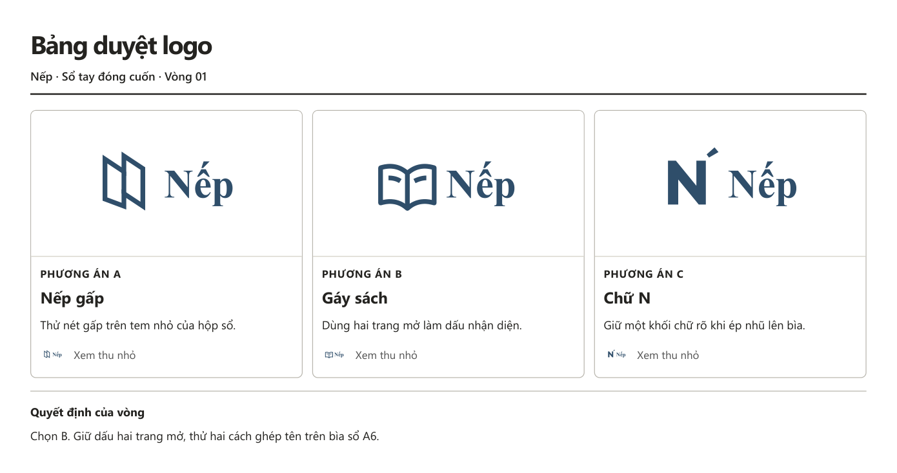

# Logo & Brand Design

Một skill tiếng Việt giúp bạn làm việc với AI từ lúc còn phân vân giữa vài ý tưởng logo đến lúc có bộ nhận diện để dùng trên màn hình, trên giấy và tại điểm bán.

Giả sử khách chọn **“giữ biểu tượng bên trái, lấy phần chữ bên phải”**. Ở vòng sau, AI cần biết chính xác hai file nào đã được duyệt. Skill này giúp bạn đặt các phương án cạnh nhau, ghi lại lựa chọn theo từng thành phần và dùng đúng bản đó khi triển khai ứng dụng tiếp theo.

**[Tải bản đóng gói](https://github.com/nkl-elep/logo-brand-design/releases/latest/download/logo-brand-design.zip)** · **[Đọc bản dành cho AI khác](Quy-trinh-logo-brand-cho-AI.md)**

*Bản PDF xuất từ bảng so sánh đi kèm. Tên thương hiệu và thiết kế trong hình là ví dụ minh họa.*

## Dùng thử với một brief

> Dùng $logo-brand-design cho thương hiệu sổ tay Nếp. Khách thấy logo lần đầu trên bìa sổ A6, sau đó là ảnh đại diện cửa hàng. Mình muốn hai phương án đọc rõ ở cả hai kích thước. Đặt chúng cạnh nhau để mình chọn trước khi làm tem và hộp.

Nếu bạn là **chủ thương hiệu**, hãy bắt đầu bằng tên, khách hàng và nơi logo sẽ xuất hiện. Nếu bạn là **designer hoặc agency**, hãy gửi brief, file logo gốc và ghi rõ phần khách đã chốt. Chẳng hạn, “Giữ biểu tượng B và màu mực. Thử hai cách ghép tên, rồi cho mình xem ở kích thước in 25 mm.”

## Cài và sử dụng

**Trong Codex.** Giải nén bản đóng gói ở trên. Chép thư mục `logo-brand-design` có file `SKILL.md` vào `~/.codex/skills/` (Windows là `%USERPROFILE%\.codex\skills\`), hoặc thư mục skills của môi trường bạn dùng. Mở một phiên mới và gọi `$logo-brand-design` cùng brief.

**Trong AI có thể đọc tệp.** Tải [tài liệu Markdown độc lập](https://raw.githubusercontent.com/nkl-elep/logo-brand-design/main/Quy-trinh-logo-brand-cho-AI.md), đính kèm nó vào cuộc trò chuyện cùng brief và tài nguyên của dự án. Khả năng tạo SVG, PDF hoặc tệp nguồn phụ thuộc vào công cụ bạn dùng.

**Trong buổi duyệt.** Mở `logo-brand-design/assets/bang-so-sanh.html` từ thư mục đã giải nén. Chọn 2–3 file logo trên máy, đổi nền sáng/tối, viết nhận xét rồi chọn **In / lưu PDF** để giữ lại quyết định. Bảng chạy ngoại tuyến trong trình duyệt.

## Tài nguyên đi kèm

| Khi bạn cần | Tài nguyên |
|---|---|
| Biến góp ý như “chưa hiện đại” thành một lần thử cụ thể | [Hướng dẫn vòng duyệt](logo-brand-design/references/vong-duyet.md) |
| Ghi lại biểu tượng, phần tên và màu của phương án đã chốt | [Phiếu quyết định](logo-brand-design/assets/phieu-quyet-dinh.md) |
| Triển khai guideline, ứng dụng online, offline và vật phẩm tại điểm bán | [Hướng dẫn triển khai](logo-brand-design/references/trien-khai.md) |
| Giao đúng logo, màu và font cho AI làm tiếp | [Mẫu thông số thương hiệu dạng JSON](logo-brand-design/assets/brand-tokens.json) |

Bạn có thể góp ý bằng [GitHub Issues](https://github.com/nkl-elep/logo-brand-design/issues). Nếu một vòng duyệt chưa ra kết quả mong muốn, mô tả brief đã ẩn danh, điều bạn đã chốt và phần AI hiểu sai để mọi người có thể thử lại.

## Giấy phép

Bạn có thể dùng, sửa đổi và phân phối lại skill, kể cả trong dự án thương mại, với điều kiện giữ thông báo bản quyền và giấy phép. [Đọc giấy phép MIT](LICENSE).
