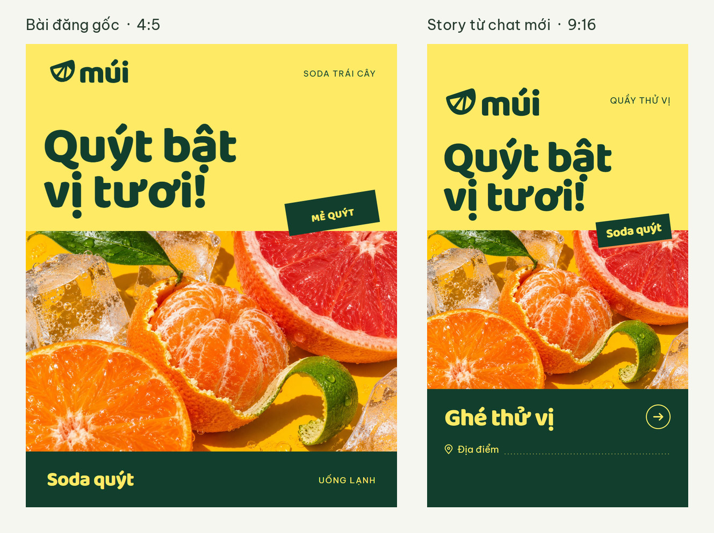
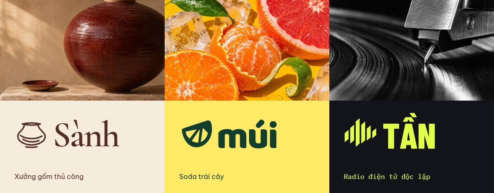

# Logo & Brand Design

Skill tiếng Việt giúp chủ thương hiệu và designer tạo logo, xây bộ nhận diện và **bàn giao thiết kế để AI khác làm tiếp**. Khi cần làm thêm một trang web, email, video hay bao bì, AI có logo gốc, mã màu, font, mẫu đã duyệt và brief để bám theo.

## Thử ngay với Múi

Múi đã có một bài đăng ra mắt soda quýt. Bạn có thể giao bộ nhận diện đó cho một chat mới để làm story mời khách ghé quầy thử vị.

Nếu dùng Codex, chạy lệnh sau trong thư mục dự án để cài skill cho dự án đó.

```sh
npx --yes skills add https://github.com/nkl-elep/logo-brand-design --skill logo-brand-design --agent codex --copy -y
```

1. [Tải gói bàn giao Múi v1.2.0](https://github.com/nkl-elep/logo-brand-design/releases/download/v1.2.0/demo-mui.zip) và giải nén.
2. Mở thư mục vừa giải nén trong một chat AI mới có thể đọc tệp và xuất ảnh. Trong gói có brief, logo gốc, font, thông số màu và bài đăng mẫu.
3. Dán nguyên lời giao việc sau.

> Dùng bộ bàn giao Múi làm story 1080 × 1920 cho quầy thử soda quýt. CTA là “Ghé thử vị”. Lấy nguyên logo từ master, đối chiếu màu và font với JSON, giữ nhịp chữ ngắn của bài đăng mẫu. Giao SVG sửa được và PNG. Chừa chỗ cho địa điểm vì brief chưa có.

**Bài đăng gốc và story từ chat mới**



Chat mới lấy logo, ảnh quýt và hai font từ gói v1.2.0. Trên khung dọc, lời mời **Ghé thử vị** nằm ngay trên dòng địa điểm để trống. Bạn có thể điền địa điểm trực tiếp trong SVG.

[Mở bài đăng gốc (PNG)](https://raw.githubusercontent.com/nkl-elep/logo-brand-design/v1.2.0/examples/mui/ung-dung/bai-ra-mat.png) · [Mở story (PNG)](https://raw.githubusercontent.com/nkl-elep/logo-brand-design/main/examples/mui/thu-ngay/story-ghe-thu-vi.png) · [Lấy story để sửa (SVG)](https://raw.githubusercontent.com/nkl-elep/logo-brand-design/main/examples/mui/thu-ngay/story-ghe-thu-vi.svg)

Bạn phải nhắc lại điều gì mà gói bàn giao lẽ ra nên nói rõ? [Gửi ảnh story và góp ý của bạn](https://github.com/nkl-elep/logo-brand-design/issues).

## Cùng một skill, ba ngành khác nhau



**[Tải skill cho Codex](https://github.com/nkl-elep/logo-brand-design/releases/latest/download/logo-brand-design.zip)** · **[Đọc bản dùng với AI khác](Quy-trinh-logo-brand-cho-AI.md)** · **[Mở riêng ảnh ba thương hiệu](https://raw.githubusercontent.com/nkl-elep/logo-brand-design/v1.2.0/docs/ba-nganh.jpg)**

Mỗi liên kết **Xem guideline** bên dưới mở một trang GitHub có đủ ba trang cẩm nang dưới dạng ảnh và phần mô tả bằng chữ. Gói ZIP dành cho lúc bạn muốn lấy file gốc để chỉnh tiếp.

### Sành · Xưởng gốm thủ công

Logo lấy nét tiện trên thân bình làm hình hiệu. Chữ có chân, màu men nâu và nền giấy mộc đi từ catalogue bán hàng đến thẻ ghi tên người làm.


[Xem guideline Sành](examples/sanh/README.md) · [Mở riêng ảnh ứng dụng](https://raw.githubusercontent.com/nkl-elep/logo-brand-design/v1.2.0/examples/sanh/xem/ung-dung.jpg) · [Tải bộ Sành](https://github.com/nkl-elep/logo-brand-design/releases/download/v1.2.0/demo-sanh.zip)

### Múi · Soda trái cây

Ba khoảng rỗng trong lát quýt trở thành dấu Múi. Chữ tròn và mảng vàng tép hiện diện trên bài đăng ra mắt, nhãn chai và thẻ đặt tại quầy thử vị.


[Xem guideline Múi](examples/mui/README.md) · [Mở riêng ảnh ứng dụng](https://raw.githubusercontent.com/nkl-elep/logo-brand-design/v1.2.0/examples/mui/xem/ung-dung.jpg) · [Tải bộ Múi](https://github.com/nkl-elep/logo-brand-design/releases/download/v1.2.0/demo-mui.zip)

### Tần · Radio điện tử độc lập

Sáu thanh tín hiệu, chữ hẹp và ảnh đĩa than đen trắng tạo nhịp cho lịch phát. Vé phiên nghe và danh sách phát dùng cùng kiểu chữ giờ để khán giả tra nhanh trong bóng tối.


[Xem guideline Tần](examples/tan/README.md) · [Mở riêng ảnh ứng dụng](https://raw.githubusercontent.com/nkl-elep/logo-brand-design/v1.2.0/examples/tan/xem/ung-dung.jpg) · [Tải bộ Tần](https://github.com/nkl-elep/logo-brand-design/releases/download/v1.2.0/demo-tan.zip)

## AI tiếp theo cần nhận gì?

Mỗi tệp trong gói Múi trả lời một câu hỏi khi AI triển khai sang kênh mới.

| Tài nguyên | Quyết định AI lấy từ đây |
|---|---|
| [Brief bàn giao Múi](examples/mui/BAN-GIAO-AI.md) | Điểm chạm sắp làm, nội dung được dùng và định dạng phải giao |
| [Thông số thương hiệu](examples/mui/brand-tokens.json) | Mã màu, cặp chữ/nền, font, vai trò màu và cỡ logo tối thiểu |
| [Logo gốc](examples/mui/logo/) và [font](examples/mui/fonts/) | Đúng hình học của lát quýt và đúng kiểu chữ tiếng Việt |
| [Ứng dụng đã dựng](examples/mui/README.md) | Cách bố trí ảnh, mật độ chữ, lề và giọng nói khi sang kênh mới |

Khi làm cho thương hiệu của bạn, điền [mẫu bàn giao cho AI](logo-brand-design/assets/ban-giao-cho-ai.md) và [mẫu thông số JSON](logo-brand-design/assets/brand-tokens.json) bằng các quyết định riêng của dự án.

## Bộ nhận diện của chính skill

Dấu ghép **LB** dùng trên icon Codex, bìa sổ duyệt A5 và phiếu chốt mẫu A6. [Xem guideline LB ngay trên GitHub](examples/skill-identity/xem/README.md) · [Xem bộ nhận diện](examples/skill-identity/README.md) · [Tải bộ LB](https://github.com/nkl-elep/logo-brand-design/releases/latest/download/demo-brand-identity.zip).

## Cài và sử dụng

**Trong Codex.** Giải nén bản đóng gói ở trên. Chép thư mục `logo-brand-design` có file `SKILL.md` vào `~/.codex/skills/` (Windows là `%USERPROFILE%\.codex\skills\`), hoặc thư mục skills của môi trường bạn dùng. Mở một phiên mới và gọi `$logo-brand-design` cùng brief.

**Trong AI có thể đọc tệp.** Tải [tài liệu Markdown độc lập](https://raw.githubusercontent.com/nkl-elep/logo-brand-design/main/Quy-trinh-logo-brand-cho-AI.md), đính kèm nó vào cuộc trò chuyện cùng brief và tài nguyên của dự án. Khả năng tạo SVG, PDF hoặc tệp nguồn phụ thuộc vào công cụ bạn dùng.

**Trong buổi duyệt.** Mở `logo-brand-design/assets/bang-so-sanh.html` từ thư mục đã giải nén. Chọn 2–3 file logo trên máy, đổi nền sáng/tối, viết nhận xét rồi chọn **In / lưu PDF** để giữ lại quyết định. Bảng chạy ngoại tuyến trong trình duyệt.

## Tài nguyên đi kèm

| Khi bạn cần | Tài nguyên |
|---|---|
| Biến góp ý như “chưa hiện đại” thành một lần thử cụ thể | [Hướng dẫn vòng duyệt](logo-brand-design/references/vong-duyet.md) |
| Ghi lại biểu tượng, phần tên và màu của phương án đã chốt | [Phiếu quyết định](logo-brand-design/assets/phieu-quyet-dinh.md) |
| Triển khai guideline, ứng dụng online, offline và vật phẩm tại điểm bán | [Hướng dẫn triển khai](logo-brand-design/references/trien-khai.md) |
| Giao đúng logo, màu và font cho AI làm tiếp | [Mẫu thông số thương hiệu dạng JSON](logo-brand-design/assets/brand-tokens.json) |

Bạn có thể góp ý bằng [GitHub Issues](https://github.com/nkl-elep/logo-brand-design/issues). Nếu một vòng duyệt chưa ra kết quả mong muốn, mô tả brief đã ẩn danh, điều bạn đã chốt và phần AI hiểu sai để mọi người có thể thử lại.

## Giấy phép

Bạn có thể dùng, sửa đổi và phân phối lại skill, kể cả trong dự án thương mại, với điều kiện giữ thông báo bản quyền và giấy phép. [Đọc giấy phép MIT](LICENSE).
