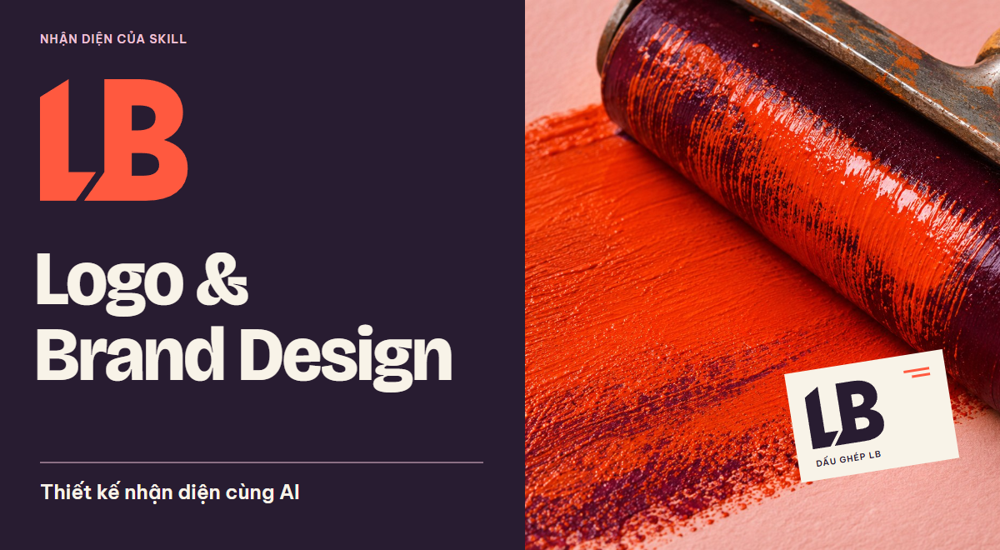
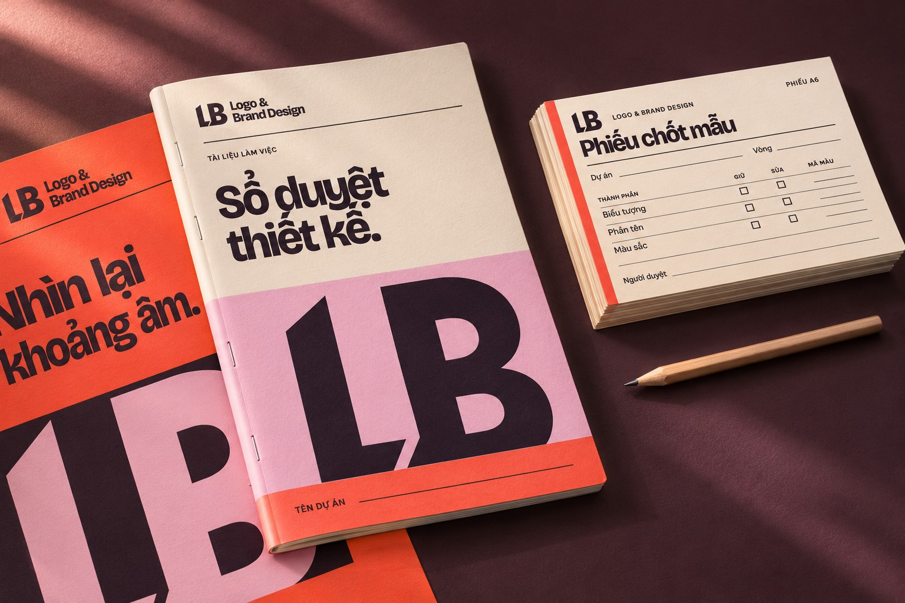

# Logo & Brand Design

Một skill tiếng Việt cho chủ thương hiệu và designer cùng làm việc với AI. Dùng nó để so sánh ý tưởng logo, ghi lại phần đã duyệt và triển khai một bộ nhận diện dùng được trên màn hình, trên giấy và tại điểm bán.

**[Tải skill](https://github.com/nkl-elep/logo-brand-design/releases/latest/download/logo-brand-design.zip)** · **[Dùng với AI đọc tệp](Quy-trinh-logo-brand-cho-AI.md)** · **[Xem brand guideline 6 trang](examples/skill-identity/brand-guideline.pdf)**

## Chính skill này cũng có một bộ nhận diện

Dấu **LB** ghép chữ L của *Logo* và chữ B của *Brand*. Một khe chéo ở chân tách hai chữ khi thu nhỏ. Cùng dấu đó xuất hiện ở icon Codex, mở rộng thành mảng hình trên bìa sổ A5 và thu về một góc trên phiếu chốt mẫu để nhường chỗ ghi tay.

*Phối cảnh minh họa bằng AI. Bản in được xuất riêng từ artwork vector, có khổ thành phẩm và tràn lề.*

Mở [bộ nhận diện mẫu](examples/skill-identity/README.md) để xem logo sáng/tối, bảng màu, kiểu chữ, avatar, bài đăng dọc và hai ấn phẩm in. Bạn có thể [tải trọn bộ demo](https://github.com/nkl-elep/logo-brand-design/releases/latest/download/demo-brand-identity.zip). Có sẵn [thông số cho AI](examples/skill-identity/brand-tokens.json) để thử triển khai thêm một điểm chạm.

## Dùng thử với một brief

> Dùng $logo-brand-design cho thương hiệu sổ tay Nếp. Khách thấy logo lần đầu trên bìa sổ A6, sau đó là ảnh đại diện cửa hàng. Mình muốn hai phương án đọc rõ ở cả hai kích thước. Đặt chúng cạnh nhau để mình chọn trước khi làm tem và hộp.

Nếu bạn là **chủ thương hiệu**, hãy bắt đầu bằng tên, khách hàng và nơi logo sẽ xuất hiện. Nếu bạn là **designer hoặc agency**, hãy gửi brief, file logo gốc và ghi rõ phần khách đã chốt. Chẳng hạn, “Giữ biểu tượng B và màu mực. Thử hai cách ghép tên, rồi cho mình xem ở kích thước in 25 mm.”

## Cài và sử dụng

**Trong Codex.** Giải nén bản đóng gói ở trên. Chép thư mục `logo-brand-design` có file `SKILL.md` vào `~/.codex/skills/` (Windows là `%USERPROFILE%\.codex\skills\`), hoặc thư mục skills của môi trường bạn dùng. Mở một phiên mới và gọi `$logo-brand-design` cùng brief.

**Trong AI có thể đọc tệp.** Tải [tài liệu Markdown độc lập](https://raw.githubusercontent.com/nkl-elep/logo-brand-design/main/Quy-trinh-logo-brand-cho-AI.md), đính kèm nó vào cuộc trò chuyện cùng brief và tài nguyên của dự án. Khả năng tạo SVG, PDF hoặc tệp nguồn phụ thuộc vào công cụ bạn dùng.

**Trong buổi duyệt.** Mở `logo-brand-design/assets/bang-so-sanh.html` từ thư mục đã giải nén. Chọn 2–3 file logo trên máy, đổi nền sáng/tối, viết nhận xét rồi chọn **In / lưu PDF** để giữ lại quyết định. Bảng chạy ngoại tuyến trong trình duyệt.

## Tài nguyên đi kèm

| Khi bạn cần | Tài nguyên |
|---|---|
| Biến góp ý như “chưa hiện đại” thành một lần thử cụ thể | [Hướng dẫn vòng duyệt](logo-brand-design/references/vong-duyet.md) |
| Ghi lại biểu tượng, phần tên và màu của phương án đã chốt | [Phiếu quyết định](logo-brand-design/assets/phieu-quyet-dinh.md) |
| Triển khai guideline, ứng dụng online, offline và vật phẩm tại điểm bán | [Hướng dẫn triển khai](logo-brand-design/references/trien-khai.md) |
| Giao đúng logo, màu và font cho AI làm tiếp | [Mẫu thông số thương hiệu dạng JSON](logo-brand-design/assets/brand-tokens.json) |

Bạn có thể góp ý bằng [GitHub Issues](https://github.com/nkl-elep/logo-brand-design/issues). Nếu một vòng duyệt chưa ra kết quả mong muốn, mô tả brief đã ẩn danh, điều bạn đã chốt và phần AI hiểu sai để mọi người có thể thử lại.

## Giấy phép

Bạn có thể dùng, sửa đổi và phân phối lại skill, kể cả trong dự án thương mại, với điều kiện giữ thông báo bản quyền và giấy phép. [Đọc giấy phép MIT](LICENSE).
