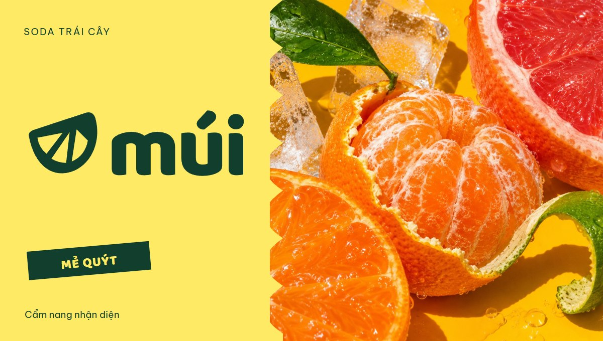
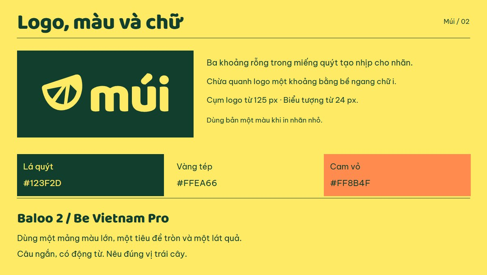
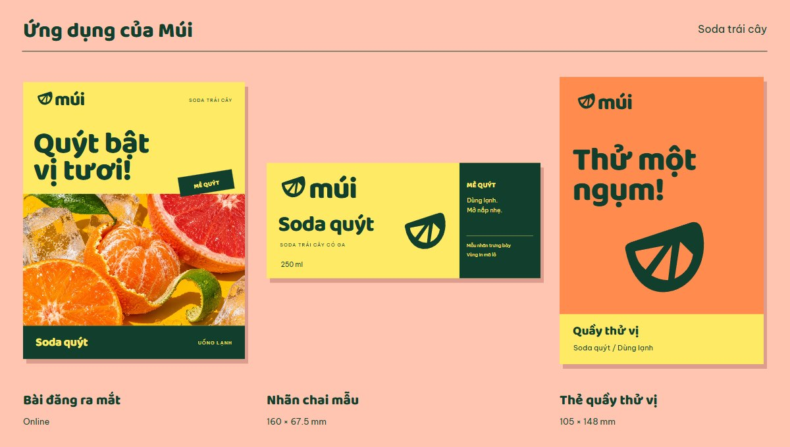

# Múi · Soda trái cây

Khách gặp Múi trên mạng, nhìn nhãn chai và chọn vị tại quầy. Bộ mẫu giả định được tạo để minh họa cách dùng skill Logo & Brand Design.

**[Mở ảnh bìa riêng](https://raw.githubusercontent.com/nkl-elep/logo-brand-design/v1.2.0/examples/mui/xem/bia.jpg)** · **[Tải guideline PDF](https://raw.githubusercontent.com/nkl-elep/logo-brand-design/v1.2.0/examples/mui/guideline.pdf)** · **[Tải bộ Múi](https://github.com/nkl-elep/logo-brand-design/releases/download/v1.2.0/demo-mui.zip)**

## Logo, màu và chữ

Ba khoảng rỗng trong miếng quýt tạo nhịp cho nhãn. Chừa quanh logo một khoảng bằng bề ngang chữ i. Cụm logo đầy đủ dùng từ 125 px, dấu rời từ 24 px. Dùng Baloo 2 cho tiêu đề, Be Vietnam Pro cho phần đọc. Dùng một mảng màu lớn, một tiêu đề tròn và một lát quả.

Lá quýt `#123F2D` · Vàng tép `#FFEA66` · Cam vỏ `#FF8B4F`. Câu ngắn, có động từ. Nêu đúng vị trái cây. [Xem riêng trang quy tắc](https://raw.githubusercontent.com/nkl-elep/logo-brand-design/v1.2.0/examples/mui/xem/quy-tac.jpg).

## Ứng dụng online và offline

| Ấn phẩm | Khổ thành phẩm | Tệp sử dụng |
|---|---|---|
| Bài đăng ra mắt | 864 × 1080 px | [Xem ảnh riêng](https://raw.githubusercontent.com/nkl-elep/logo-brand-design/v1.2.0/examples/mui/xem/bai-ra-mat.jpg) · [Nguồn SVG](ung-dung/bai-ra-mat.svg) · [Tải PNG](https://raw.githubusercontent.com/nkl-elep/logo-brand-design/v1.2.0/examples/mui/ung-dung/bai-ra-mat.png) |
| Nhãn chai mẫu | 160 × 67.5 mm | [Xem ảnh riêng](https://raw.githubusercontent.com/nkl-elep/logo-brand-design/v1.2.0/examples/mui/xem/nhan-chai.jpg) · [Nguồn SVG](ung-dung/nhan-chai.svg) · [Tải PDF](https://raw.githubusercontent.com/nkl-elep/logo-brand-design/v1.2.0/examples/mui/ung-dung/nhan-chai.pdf) |
| Thẻ quầy thử vị | 105 × 148 mm | [Xem ảnh riêng](https://raw.githubusercontent.com/nkl-elep/logo-brand-design/v1.2.0/examples/mui/xem/the-thu-vi.jpg) · [Nguồn SVG](ung-dung/the-thu-vi.svg) · [Tải PDF](https://raw.githubusercontent.com/nkl-elep/logo-brand-design/v1.2.0/examples/mui/ung-dung/the-thu-vi.pdf) |

Trong SVG, các tên font nội bộ Serif, Round, Tall, Sans và Mono lần lượt chỉ Cormorant Garamond, Baloo 2, Barlow Condensed, Be Vietnam Pro và IBM Plex Mono. Khi phần mềm không đọc font nhúng, gán lại hai font ghi trong guideline.

Các bản in dùng sRGB và có tràn lề 3 mm. Ảnh chất liệu trong bộ do AI tạo. Xem màu trên vật liệu trước khi sản xuất. [Mở ảnh ứng dụng riêng](https://raw.githubusercontent.com/nkl-elep/logo-brand-design/v1.2.0/examples/mui/xem/ung-dung.jpg).

## Giao cho AI làm tiếp

> Làm story 1080 × 1920 cho quầy thử soda quýt, CTA “Ghé thử vị”.

Đính kèm [brief và quyết định của demo](BAN-GIAO-AI.md), [thông số JSON](brand-tokens.json), đúng [logo gốc](logo/) và một mẫu ứng dụng. [Thư mục font](fonts/) chứa font cùng giấy phép SIL Open Font License.
