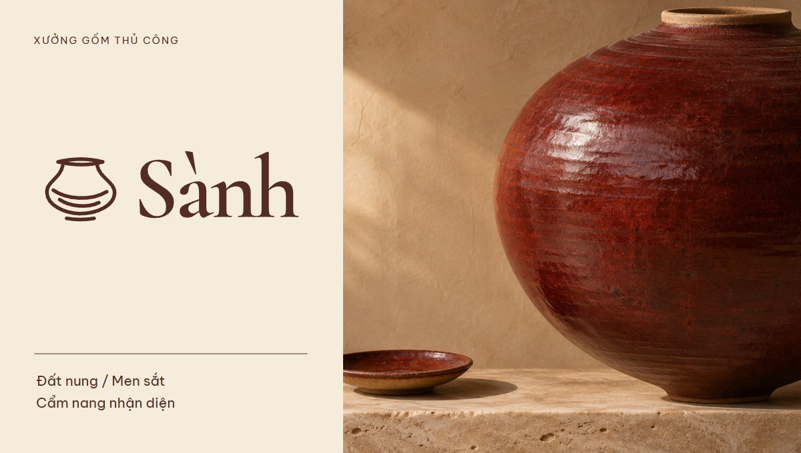
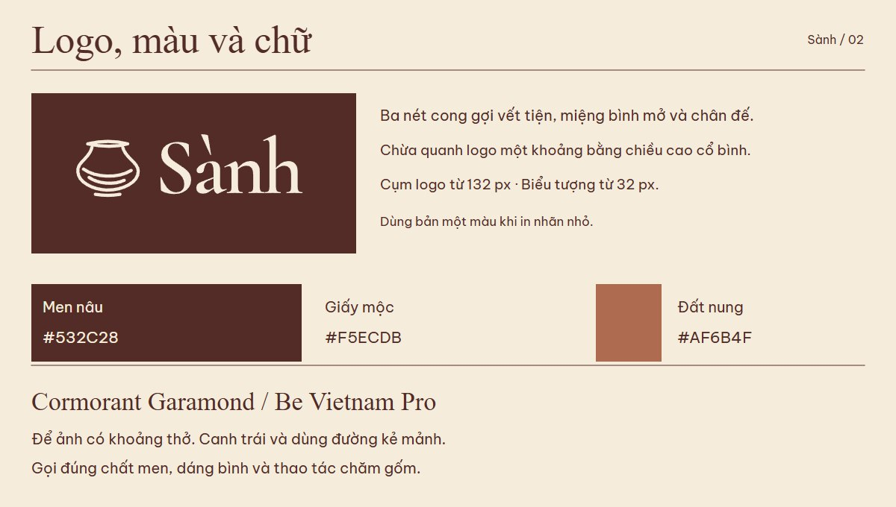
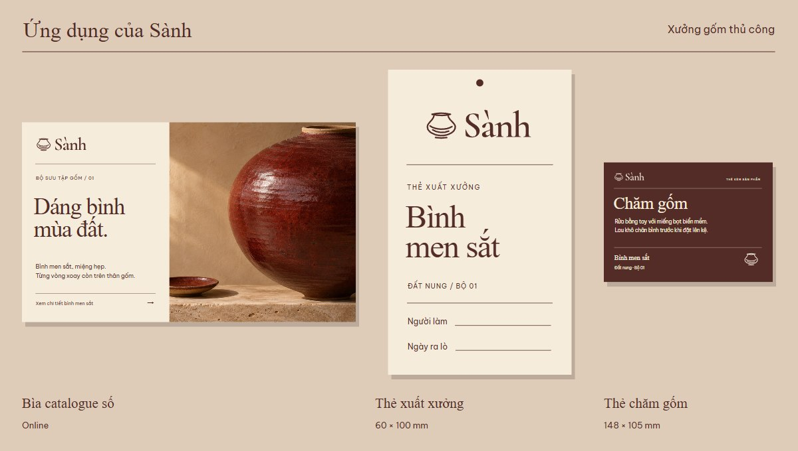

# Sành · Xưởng gốm thủ công

Khách xem bình trên catalogue, rồi nhận thẻ của xưởng cùng sản phẩm. Bộ mẫu giả định được tạo để minh họa cách dùng skill Logo & Brand Design.

**[Mở ảnh bìa riêng](https://raw.githubusercontent.com/nkl-elep/logo-brand-design/v1.2.0/examples/sanh/xem/bia.jpg)** · **[Cẩm nang thương hiệu Sành (PDF)](https://raw.githubusercontent.com/nkl-elep/logo-brand-design/v1.2.0/examples/sanh/guideline.pdf)** · **[Tải gói bàn giao Sành (ZIP)](https://github.com/nkl-elep/logo-brand-design/releases/download/v1.2.1/demo-sanh.zip)**

## Logo, màu và chữ

Ba nét cong gợi vết tiện, miệng bình mở và chân đế. Chừa quanh logo một khoảng bằng chiều cao cổ bình. Cụm logo đầy đủ dùng từ 132 px, dấu rời từ 32 px. Dùng Cormorant Garamond cho tiêu đề, Be Vietnam Pro cho phần đọc. Để ảnh có khoảng thở. Canh trái và dùng đường kẻ mảnh.

Men nâu `#532C28` · Giấy mộc `#F5ECDB` · Đất nung `#AF6B4F`. Gọi đúng chất men, dáng bình và thao tác chăm gốm. [Xem riêng trang quy tắc](https://raw.githubusercontent.com/nkl-elep/logo-brand-design/v1.2.0/examples/sanh/xem/quy-tac.jpg).

## Ứng dụng online và offline

| Ấn phẩm | Khổ thành phẩm | Tệp sử dụng |
|---|---|---|
| Bìa catalogue số | 1200 × 720 px | [Xem ảnh riêng](https://raw.githubusercontent.com/nkl-elep/logo-brand-design/v1.2.0/examples/sanh/xem/catalogue.jpg) · [Nguồn SVG](ung-dung/catalogue.svg) · [Tải PNG](https://raw.githubusercontent.com/nkl-elep/logo-brand-design/v1.2.0/examples/sanh/ung-dung/catalogue.png) |
| Thẻ xuất xưởng | 60 × 100 mm | [Xem ảnh riêng](https://raw.githubusercontent.com/nkl-elep/logo-brand-design/v1.2.0/examples/sanh/xem/the-xuat-xuong.jpg) · [Nguồn SVG](ung-dung/the-xuat-xuong.svg) · [Tải PDF](https://raw.githubusercontent.com/nkl-elep/logo-brand-design/v1.2.0/examples/sanh/ung-dung/the-xuat-xuong.pdf) |
| Thẻ chăm gốm | 148 × 105 mm | [Xem ảnh riêng](https://raw.githubusercontent.com/nkl-elep/logo-brand-design/v1.2.0/examples/sanh/xem/the-cham-gom.jpg) · [Nguồn SVG](ung-dung/the-cham-gom.svg) · [Tải PDF](https://raw.githubusercontent.com/nkl-elep/logo-brand-design/v1.2.0/examples/sanh/ung-dung/the-cham-gom.pdf) |

Trong SVG, các tên font nội bộ Serif, Round, Tall, Sans và Mono lần lượt chỉ Cormorant Garamond, Baloo 2, Barlow Condensed, Be Vietnam Pro và IBM Plex Mono. Khi phần mềm không đọc font nhúng, gán lại hai font ghi trong cẩm nang thương hiệu.

Các bản in dùng sRGB và có tràn lề 3 mm. Ảnh chất liệu trong bộ do AI tạo. Xem màu trên vật liệu trước khi sản xuất. [Mở ảnh ứng dụng riêng](https://raw.githubusercontent.com/nkl-elep/logo-brand-design/v1.2.0/examples/sanh/xem/ung-dung.jpg).

## Giao cho AI làm tiếp

> Thiết kế thiệp mời xem bộ bình men sắt, khổ vuông 1080 px.

Đính kèm [phiếu bàn giao cho AI · Sành](BAN-GIAO-AI.md), [thông số thương hiệu (JSON)](brand-tokens.json), đúng [logo gốc](logo/) và một mẫu ứng dụng. [Thư mục font](fonts/) chứa font cùng giấy phép SIL Open Font License.
