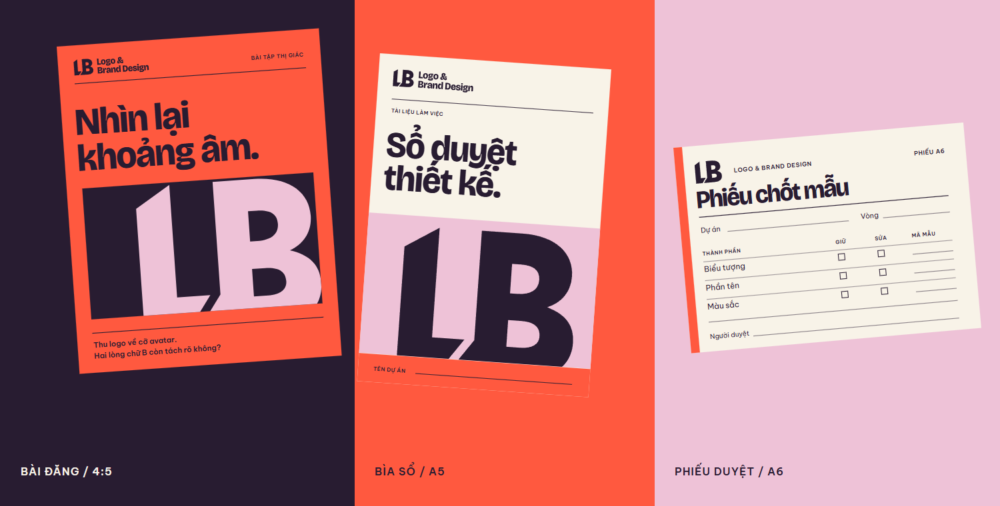

# Bộ nhận diện của Logo & Brand Design

Bộ nhận diện minh họa cho chính skill **Logo & Brand Design**, dành cho chủ thương hiệu và người thiết kế cùng duyệt một phương án. Dấu ghép **LB** xuất hiện trên biểu tượng Codex và trên phiếu in một màu dùng trong buổi duyệt.

## Quyết định thiết kế

Hai chữ cái đầu đứng trên cùng một đường chân. Một khe cắt chéo chia phần chân chữ L và bụng chữ B. Khi thu về avatar, hai khoảng âm của B là chi tiết dùng để kiểm tra độ rõ. Tựa ngắn dùng Bricolage Grotesque, nội dung tiếng Việt dùng Be Vietnam Pro. Màu Son lấy từ mực lăn trong xưởng in, Mực tím dùng cho nét chữ, Giấy ngà và Phấn hồng dùng cho các bề mặt.

Đây là phương án do người thiết kế chọn cho bộ demo. Quy tắc màu và font áp dụng cho bộ này. Khi dùng skill cho một thương hiệu khác, hãy lấy thông số từ brief và master của thương hiệu đó.

## Mở, chỉnh và xuất

| Dùng cho | Tệp |
|---|---|
| Đọc cẩm nang 6 trang hoặc chỉnh từng trang | [Xem 6 trang trên GitHub](xem/README.md) · [Tải PDF](https://raw.githubusercontent.com/nkl-elep/logo-brand-design/v1.2.0/examples/skill-identity/brand-guideline.pdf) · [Nguồn SVG](guideline/) |
| Chèn đúng logo trên hai loại nền | [Logo tối](logo/lockup-dark.svg) · [Logo sáng](logo/lockup-light.svg) · [Biểu tượng](logo/monogram.svg) |
| Dùng trên môi trường số | [Avatar PNG](applications/avatar.png) · [Avatar SVG](applications/avatar.svg) · [Bài đăng PNG](applications/social.png) · [Nguồn bài đăng](applications/social.svg) |
| In, ký và ghi chú khi duyệt | [Bìa sổ A5](applications/workbook-a5.pdf) · [Nguồn bìa](applications/workbook-a5.svg) · [Phiếu A6](applications/decision-a6.pdf) · [Nguồn phiếu](applications/decision-a6.svg) |
| Giao AI làm tiếp | [Thông số thương hiệu](brand-tokens.json) · [Font và giấy phép OFL](fonts/) |

Bản logo đủ tên dùng từ 160 px, biểu tượng rời từ 24 px. Ở cỡ 16 px, dùng icon nền đặc. Các bản in có khổ thành phẩm A5 và A6 và tràn lề 3 mm. File dùng màu sRGB. Cần in thử trên vật liệu trước khi chốt màu sản xuất.

Có thể sửa chữ trong SVG của ấn phẩm. Nếu trình biên tập bỏ qua font nhúng, cài font ở thư mục trên và gán Bricolage Grotesque cho tiêu đề, Be Vietnam Pro Regular/SemiBold cho nội dung và nhãn. Phần tên trong master logo đã chuyển thành đường nét.

Ảnh con lăn mực và [phối cảnh ấn phẩm](images/print-study.jpg) là ảnh minh họa tạo bằng AI. PDF và SVG lấy từ artwork gốc. Font đi kèm theo SIL Open Font License; các điều khoản nằm trong thư mục fonts.
