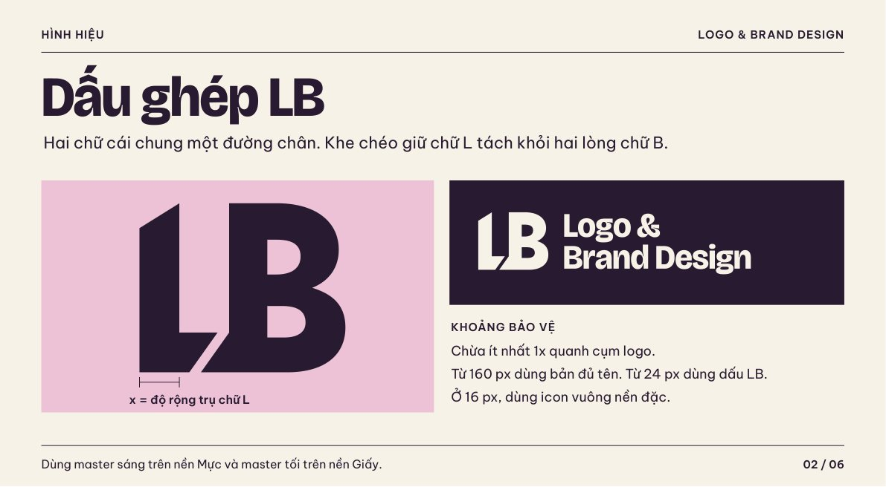
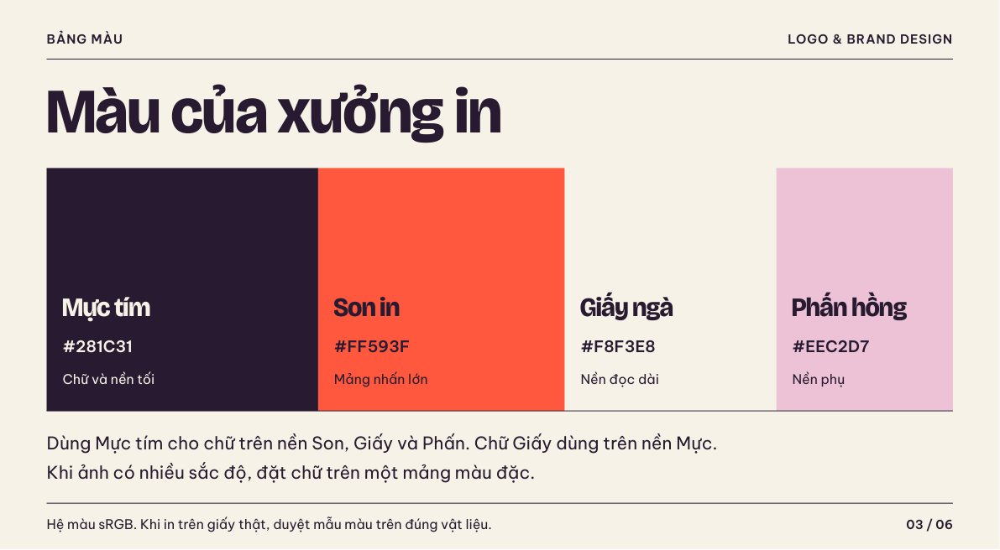
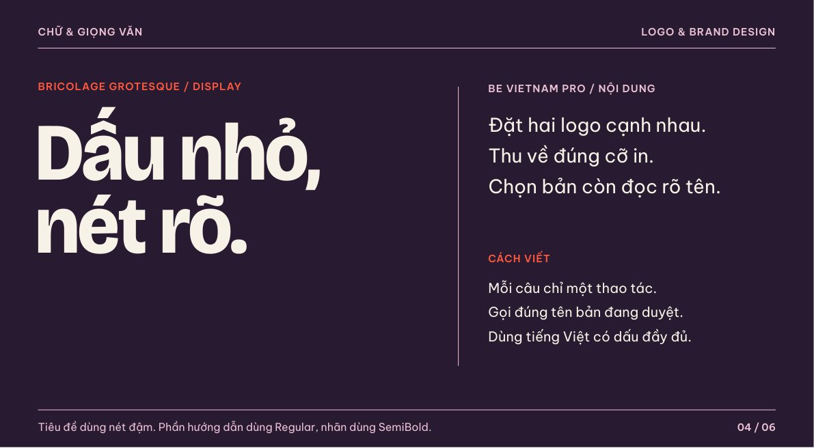
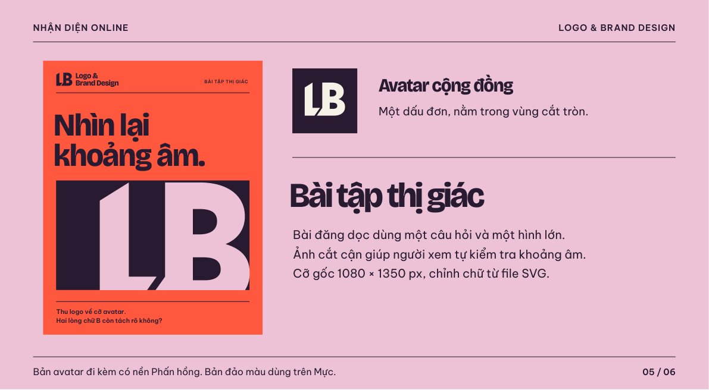
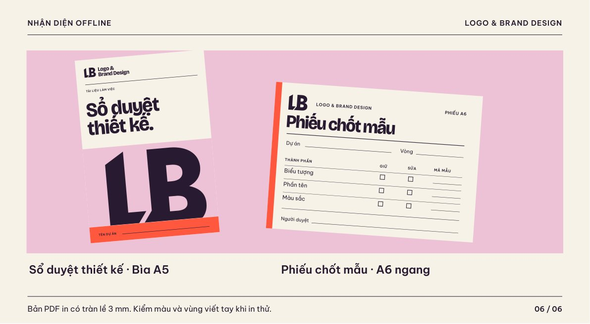

# Cẩm nang thương hiệu của Logo & Brand Design

Sáu trang dưới đây được xuất trực tiếp từ cẩm nang thương hiệu. [Tải PDF](https://raw.githubusercontent.com/nkl-elep/logo-brand-design/v1.2.0/examples/skill-identity/brand-guideline.pdf) · [Mở bộ nguồn](../README.md).

## 1. Bìa

## 2. Hình hiệu

## 3. Bảng màu

## 4. Chữ và giọng văn

## 5. Nhận diện online

## 6. Nhận diện offline

