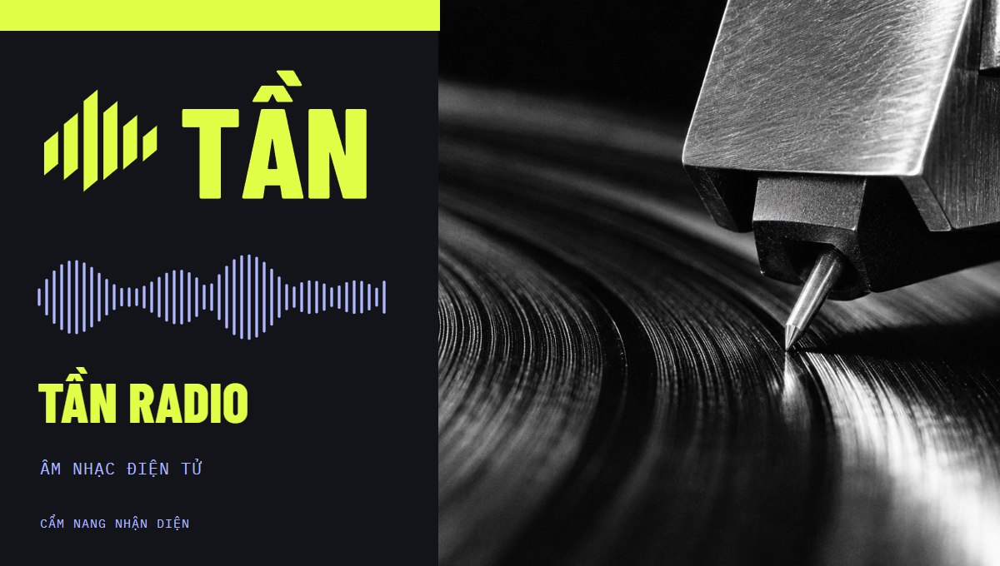
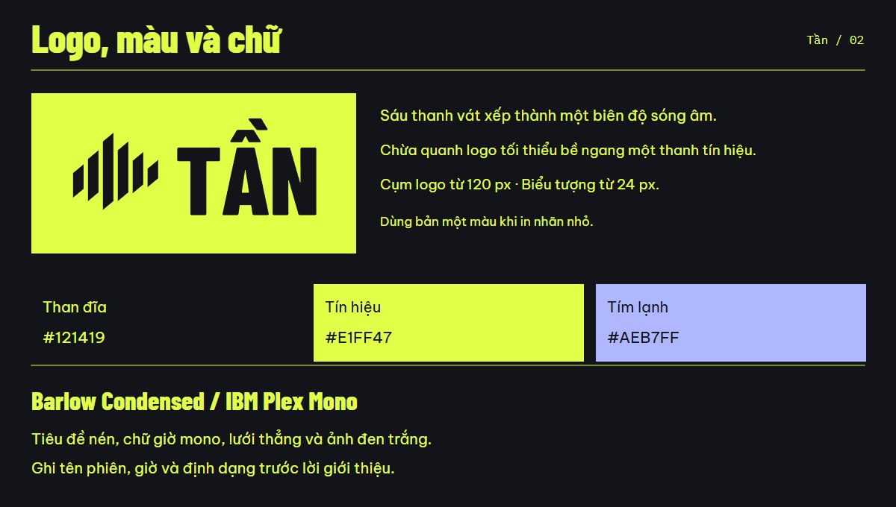
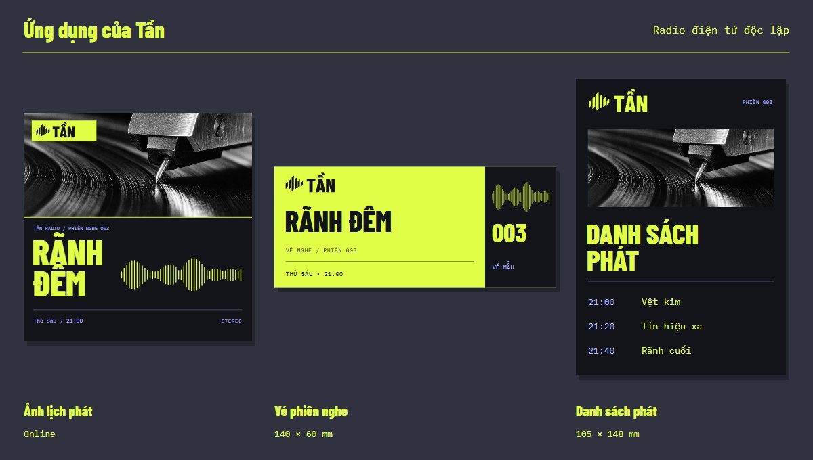

# Tần · Radio điện tử độc lập

Người nghe lưu lịch phát, giữ vé và theo dõi các đoạn nhạc. Bộ mẫu giả định được tạo để minh họa cách dùng skill Logo & Brand Design.

**[Mở ảnh bìa riêng](https://raw.githubusercontent.com/nkl-elep/logo-brand-design/v1.2.0/examples/tan/xem/bia.jpg)** · **[Tải guideline PDF](https://raw.githubusercontent.com/nkl-elep/logo-brand-design/v1.2.0/examples/tan/guideline.pdf)** · **[Tải bộ Tần](https://github.com/nkl-elep/logo-brand-design/releases/download/v1.2.0/demo-tan.zip)**

## Logo, màu và chữ

Sáu thanh vát xếp thành một biên độ sóng âm. Chừa quanh logo tối thiểu bề ngang một thanh tín hiệu. Cụm logo đầy đủ dùng từ 120 px, dấu rời từ 24 px. Dùng Barlow Condensed cho tiêu đề, IBM Plex Mono cho phần đọc. Tiêu đề nén, chữ giờ mono, lưới thẳng và ảnh đen trắng.

Than đĩa `#121419` · Tín hiệu `#E1FF47` · Tím lạnh `#AEB7FF`. Ghi tên phiên, giờ và định dạng trước lời giới thiệu. [Xem riêng trang quy tắc](https://raw.githubusercontent.com/nkl-elep/logo-brand-design/v1.2.0/examples/tan/xem/quy-tac.jpg).

## Ứng dụng online và offline

| Ấn phẩm | Khổ thành phẩm | Tệp sử dụng |
|---|---|---|
| Ảnh lịch phát | 1080 × 1080 px | [Xem ảnh riêng](https://raw.githubusercontent.com/nkl-elep/logo-brand-design/v1.2.0/examples/tan/xem/lich-phat.jpg) · [Nguồn SVG](ung-dung/lich-phat.svg) · [Tải PNG](https://raw.githubusercontent.com/nkl-elep/logo-brand-design/v1.2.0/examples/tan/ung-dung/lich-phat.png) |
| Vé phiên nghe | 140 × 60 mm | [Xem ảnh riêng](https://raw.githubusercontent.com/nkl-elep/logo-brand-design/v1.2.0/examples/tan/xem/ve-phien-nghe.jpg) · [Nguồn SVG](ung-dung/ve-phien-nghe.svg) · [Tải PDF](https://raw.githubusercontent.com/nkl-elep/logo-brand-design/v1.2.0/examples/tan/ung-dung/ve-phien-nghe.pdf) |
| Danh sách phát | 105 × 148 mm | [Xem ảnh riêng](https://raw.githubusercontent.com/nkl-elep/logo-brand-design/v1.2.0/examples/tan/xem/danh-sach-phat.jpg) · [Nguồn SVG](ung-dung/danh-sach-phat.svg) · [Tải PDF](https://raw.githubusercontent.com/nkl-elep/logo-brand-design/v1.2.0/examples/tan/ung-dung/danh-sach-phat.pdf) |

Trong SVG, các tên font nội bộ Serif, Round, Tall, Sans và Mono lần lượt chỉ Cormorant Garamond, Baloo 2, Barlow Condensed, Be Vietnam Pro và IBM Plex Mono. Khi phần mềm không đọc font nhúng, gán lại hai font ghi trong guideline.

Các bản in dùng sRGB và có tràn lề 3 mm. Ảnh chất liệu trong bộ do AI tạo. Xem màu trên vật liệu trước khi sản xuất. [Mở ảnh ứng dụng riêng](https://raw.githubusercontent.com/nkl-elep/logo-brand-design/v1.2.0/examples/tan/xem/ung-dung.jpg).

## Giao cho AI làm tiếp

> Tạo ảnh nhắc giờ cho Phiên 003 lúc 21:00, khổ 1080 × 1920.

Đính kèm [brief và quyết định của demo](BAN-GIAO-AI.md), [thông số JSON](brand-tokens.json), đúng [logo gốc](logo/) và một mẫu ứng dụng. [Thư mục font](fonts/) chứa font cùng giấy phép SIL Open Font License.
